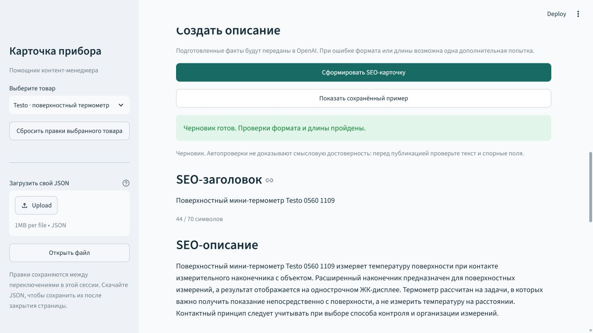

# Карточка прибора

Локальный помощник для подготовки товарных описаний B2B-магазина измерительных приборов.

Подготовлены четыре набора исходных данных, интерфейс редактирования и генерация SEO-карточек через OpenAI GPT-6 Luna. Генератор использует строгую JSON-схему, проверку длины и подстановку исходных технических значений. Исходные данные и готовая карточка скачиваются отдельно.

Для демонстрации без незаполненных полей выберите **Testo 608-H1** или **Testo 608-H2**. У каждого заполнены 22 характеристики. Первые Testo 0560 1109 и APPA 61 сохранены для демонстрации обработки пропусков и конфликтов. Происхождение новых данных и границы проверки описаны в [data/additional-products.md](data/additional-products.md).

Готовые результаты: [608-H1](examples/generated/testo-608-h1.md), [608-H2](examples/generated/testo-608-h2.md), [Testo 0560 1109](examples/generated/testo-0560-1109.md), [APPA 61](examples/generated/appa-61.md), [JSON для самостоятельной проверки](examples/input-product.json).

## Запуск

Проверено на Python 3.12. Для проекта рекомендуется Python 3.12 или 3.13.

```powershell
python -m venv .venv
.\.venv\Scripts\python.exe -m pip install -r requirements.txt
if (-not (Test-Path .env)) { Copy-Item .env.example .env }
.\.venv\Scripts\python.exe -m streamlit run app.py
```

Перед запуском укажите свой ключ в `.env`: `OPENAI_API_KEY=...`. Команду копирования пропустите, если `.env` уже существует, чтобы не затереть ключ. Также поддерживается существующее имя `open_ai` без учёта регистра. Переменные окружения имеют приоритет над файлом. `.env` исключён из Git; ключ не попадает в интерфейс, результаты или сообщения об ошибках.

Откройте http://127.0.0.1:8501. Активация окружения PowerShell не нужна. Если окружение создано через `uv`, используйте `uv pip install --python .venv/Scripts/python.exe -r requirements.txt`.

В macOS/Linux используйте:

```bash
python3 -m venv .venv
.venv/bin/python -m pip install -r requirements.txt
test -f .env || cp .env.example .env
# Укажите OPENAI_API_KEY в .env для новой генерации.
.venv/bin/python -m streamlit run app.py
```

Без API-ключа можно открыть встроенные товары и нажать «Показать сохранённый пример». Новая генерация станет доступна после добавления собственного ключа. Для запуска после перезагрузки компьютера повторите команду Streamlit; при запуске в терминале оставляйте его открытым. Если после правок Python-модулей видна старая версия, остановите сервер через Ctrl+C, запустите снова и обновите страницу.

## Быстрая проверка со своим JSON

Готовый файл: [examples/input-product.json](examples/input-product.json). Он содержит данные Testo 608-H1 в базовом формате задания: название, производитель, характеристики и описание. Источники этих данных описаны в [data/additional-products.md](data/additional-products.md).

1. Выберите «Свой товар», замените содержимое поля «Данные товара в JSON» текстом ниже и нажмите Ctrl+Enter.
2. Убедитесь, что справа показаны 22 характеристики и «Требует уточнения: 0».
3. Нажмите «Сформировать SEO-карточку» (нужен API-ключ, запрос платный). После успешной генерации появятся заголовок, описание 800–1200 символов, 3–5 запросов, блок для менеджера и кнопки экспорта.

Также можно загрузить `examples/input-product.json` через «Загрузить свой JSON» → «Открыть файл»: он откроется как «Свой товар».

<details>
<summary>Готовый JSON для копирования</summary>

```json
{
  "name": "Термогигрометр Testo 608-H1",
  "manufacturer": "Testo",
  "specs": {
    "Измеряемые величины": "Температура воздуха, относительная влажность; расчёт точки росы",
    "Диапазон измерения температуры воздуха": "0…+50 °C",
    "Погрешность температуры при +25 °C": "±0,5 °C",
    "Разрешение температуры": "0,1 °C",
    "Диапазон измерения относительной влажности": "10…95 % отн. влажности, без конденсации",
    "Погрешность относительной влажности": "±3 % отн. влажности при +25 °C",
    "Температурный коэффициент влажности": "Типовой (k=1): 0,06 % отн. влажности/К",
    "Долговременная стабильность влажности": "±1 % отн. влажности в год",
    "Разрешение относительной влажности": "0,1 % отн. влажности",
    "Диапазон расчёта точки росы": "−20…+50 °C",
    "Интервал измерений": "18 с",
    "Дисплей": "ЖК, 2 строки",
    "Минимальные и максимальные значения": "Отображение минимальных и максимальных показаний",
    "Установка": "Настольная или настенная",
    "Рабочая температура": "0…+50 °C",
    "Температура хранения": "−40…+70 °C",
    "Питание": "Батарея 9 В, тип 6F22",
    "Ресурс батареи": "Приблизительно 1 год",
    "Материал корпуса": "ABS",
    "Размеры (Ш × В × Г)": "111 × 90 × 40 мм",
    "Масса": "168 г",
    "Сигнализация": "Нет; LED-сигнализация предусмотрена только у модели H2"
  },
  "description": "Прибор для постоянного наблюдения за температурой и относительной влажностью воздуха в помещениях. Рассчитывает точку росы, показывает текущие, минимальные и максимальные значения. Подходит для контроля микроклимата в офисах, складских помещениях, лабораториях и садовых центрах. Его можно поставить на стол или закрепить на стене. Показания считываются с дисплея; предусмотрена индикация разряда батареи. Измерение влажности выполняется без конденсации. Светодиодной сигнализации предельных значений у этой модели нет."
}
```

</details>

## Использование

1. Выберите один из четырёх примеров или «Свой товар».
2. Отредактируйте JSON слева. Значения характеристик задавайте текстом с единицами, неизвестные — `null`.
3. Нажмите Ctrl+Enter или выйдите из поля: справа обновятся данные, замечания и источники.
4. При необходимости загрузите UTF-8 JSON до 1 МБ и нажмите «Открыть файл». Корректный файл откроется как «Свой товар»; при ошибке текущий черновик сохранится.
5. Скачайте JSON/Markdown или скопируйте Markdown из раскрывающегося блока.
6. Нажмите «Сформировать SEO-карточку». Это платный запрос к OpenAI. При необходимости приложение один раз попросит исправить формат или длину результата.
7. Проверьте SEO-заголовок, описание, запросы и блок для менеджера; скачайте карточку отдельными кнопками. Спорные поля сохраняются в замечаниях. После изменения исходных данных устаревшая карточка скрывается до новой генерации.

Для встроенных товаров доступна кнопка «Показать сохранённый пример»: она открывает реальный результат предыдущей генерации без нового запроса. Пример показывается только при совпадении исходных данных. Чтобы получить новые результаты на диске, запустите `python scripts/generate_examples.py` из установленного окружения; команда платная и перезаписывает файлы в `examples/generated/`. Только новые товары: `python scripts/generate_examples.py --products testo-608-h1 testo-608-h2`.

Правки сохраняются отдельно для каждого товара в текущей сессии браузера. Перезагрузка/закрытие страницы может завершить сессию; постоянное хранение — через скачивание. Кнопка сброса восстанавливает только выбранный пример. Файлы в `data/products/` приложение не изменяет.

Минимальный допустимый объект:

```json
{
  "name": "Название прибора",
  "manufacturer": null,
  "specs": {},
  "description": ""
}
```

Только название обязательно для просмотра. Пустые производитель, описание и характеристики отображаются как недостающие сведения. Неизвестные поля, повторяющиеся JSON-ключи, неверные типы и ошибочные ссылки между источниками и замечаниями отклоняются. Числа не преобразуются в характеристики автоматически: `"Питание": "24 В"`, а не `"Питание": 24`.

При заполнении ранее спорного поля нужно проверить значение, обновить источники и удалить соответствующее замечание из `data_issues`. Приложение не считает пользовательские значения подтверждёнными автоматически и не загружает внешние ссылки. Источники после редактирования необходимо актуализировать вручную. Пустые поля обнаруживаются автоматически; отсутствие характеристик, которые вообще не перечислены во входных данных, по типу прибора пока не определяется.

## Проверки

```powershell
.\.venv\Scripts\python.exe -m unittest discover -s tests -v
```

Проверяются сохранность исходных характеристик при экспорте, неполные/некорректные данные, конфликты и ссылки на источники, переключение черновиков, скрытие устаревших результатов, ограниченный повтор, обработка ошибок API без раскрытия ключа и подсчёт расхода обеих попыток. Тесты не вызывают платный API. UI-проверки используют встроенный Streamlit AppTest без внешнего браузера.

Перед сдачей локально прошли 28 тестов (Python 3.12, Windows). GitHub Actions запускает тот же набор на Python 3.12; результат CI появится после загрузки репозитория.

## Структура

- `app.py` — интерфейс Streamlit и состояние черновиков.
- `product_assistant/data.py` — Pydantic-модели, проверка JSON, сбор замечаний и экспорт.
- `product_assistant/generation.py` — вызов Luna, подстановка фактов, проверки и экспорт карточки.
- `product_assistant/prompts.py` — системный промпт с версией.
- `product_assistant/settings.py` — чтение ключа из окружения или `.env`.
- `product_assistant/text_limits.py` — сокращение длинного описания по границам предложений.
- `data/products/` — четыре исходных примера.
- `examples/generated/` — реальные результаты API, расход токенов и сведения о проверке.
- `scripts/generate_examples.py` — повторная генерация всех или выбранных примеров; требует ключ и расходует токены.
- `data/README.md` — происхождение данных и найденные расхождения.
- `tests/` — проверки обработки данных и пользовательских сценариев.
- `.streamlit/config.toml` — тема, локальный адрес и отключение телеметрии Streamlit.
- `.github/workflows/tests.yml` — запуск тестов при push и pull request, без API-ключа.
- `docs/submission.md` — подготовленное сопроводительное сообщение.

## Интерфейс



## Принятые решения

- Модель фиксирована: `gpt-6-luna`, Responses API, `reasoning.effort=low`, стандартный тариф, `max_output_tokens=3500`. Автоматической смены на дорогую модель нет.
- На одну генерацию — максимум два содержательных запроса: основной и исправление. SDK-повторы отключены. Таймаут запроса — 60 секунд; при сетевой ошибке пользователь получает понятное сообщение. Таймаут не означает, что сервер не обработал запрос.
- `store=False`; приложение не сохраняет ответы в хранилище Responses. Это не отменяет политики журналирования/хранения провайдера.
- Модели передаётся компактный каталог фактов. URL, тексты руководств целиком и альтернативные конфликтующие значения не отправляются. Неизвестные поля перечисляются по названиям.
- Внутри ответа модель использует ссылки `{{name}}`, `{{spec_0}}` и т. п. Приложение подставляет исходные значения целиком, вместе с условиями. В пользовательском результате ссылок нет; в JSON хранится список `evidence` для сверки подставленных фактов.
- Проверяются заголовок до 70 символов, описание 800–1200 символов с пробелами, 3–5 разных запросов, наличие commercial-блока, неизвестные ссылки и цифры вне ссылок. Таблица характеристик всегда строится из входа.
- Если единственная ошибка — описание длиннее 1200 символов, приложение пробует убрать заключительные предложения. Граница выбирается до подстановки фактов, длина считается после неё. Ссылки на факты не разрезаются и не удаляются; окончания с признаками ограничений («без», «только», «при», «погрешность» и т. п.) сохраняются. Затем вся карточка проверяется повторно. Сокращение отмечается в интерфейсе и экспорте и не требует API. Если подходящей границы в пределах 800–1200 нет, действует обычная одна попытка исправления моделью; непрошедший проверку текст не выдаётся как готовая карточка. Лексическая защита ограничений не заменяет смысловую проверку редактором. Гарантируется длина успешного результата, а не успех каждого запроса.
- Если фактов недостаточно, сервис сообщает об этом; для одного названия без описания и характеристик запрос вообще не отправляется.

## Ограничения и улучшения

Автопроверка подтверждает формат, длину и точное копирование вставленных фактов, но не доказывает смысловую достоверность свободного текста. Модель может неправильно связать корректный факт с выводом или придумать качественное свойство словами. Перед публикацией нужен просмотр контент-менеджером; ссылки на факты сами по себе не являются семантической проверкой.

Сохранённые примеры — демонстрация на четырёх товарах, а не оценка качества на всём каталоге. Для развития нужны проверочный набор по категориям приборов, оценка утверждений и условий применения, удобная форма вместо редактирования JSON и загрузка паспортов с подтверждением извлечённых фактов.

